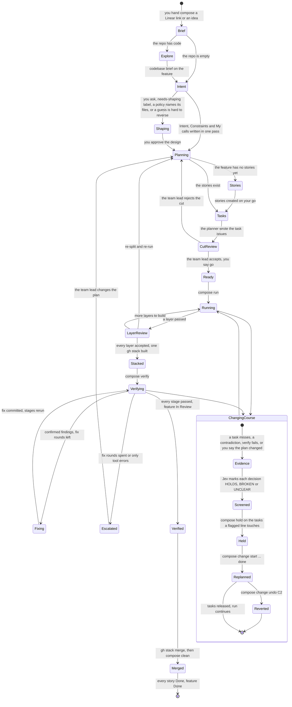
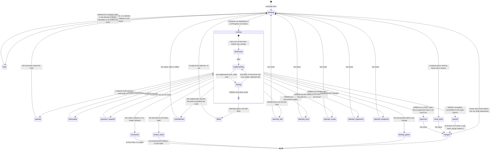
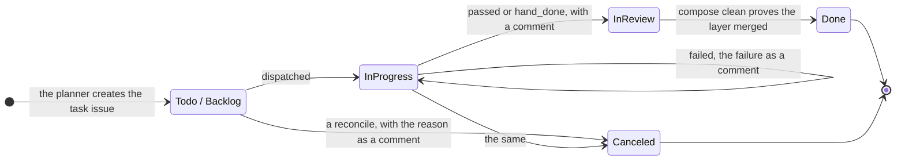

# States

Three state machines run a feature through compose: the feature itself, each task's result, and each task's Linear issue.
This page draws all three and names the command or event behind every move.
[how-it-works.md](how-it-works.md) tells the same story in prose.

## The feature

A feature is one compose project, one worktree and one gh stack.
It starts as a brief and ends when its stack merges.

Nothing is pushed until `gh stack merge`, and the CLI never marks the feature Done on its own: that needs the project branch merged.

## A task

Each task is one stack layer, built by one implementer in its own clone.
Its state lives in `results/<id>.json` and is what `compose status` shows.

The final states the CLI writes are `passed`, `already_green`, `failed`, `contradiction`, `unproven`, `broken_base`, the five `rejected_*`, `payment_required`, `interrupted`, `hand_done`, `unchained` and `paused`.
`merged` and `held` are derived by `status` from the branch, trunk and `hold.json`, never written to a result.
A design task has no branch: In Review or Done on Linear counts as passed, and it is never merged.

## The Linear issue

The CLI writes to Linear only to keep states true, and each move goes through one state table.
A story takes the state of its tasks, and the feature the state of its stories.

The roll-up rules, per story and then per feature:

- Done when every child that is not Canceled is Done.
- In Review when every such child is In Review or Done, but the feature reaches In Review only once verify passed.
- In Progress once any child started.
- Otherwise left as it is.

A blocker frees what it blocks when it is Done or Canceled, when it is In Review carrying the Design label, or when it is In Review under the same parent story.
